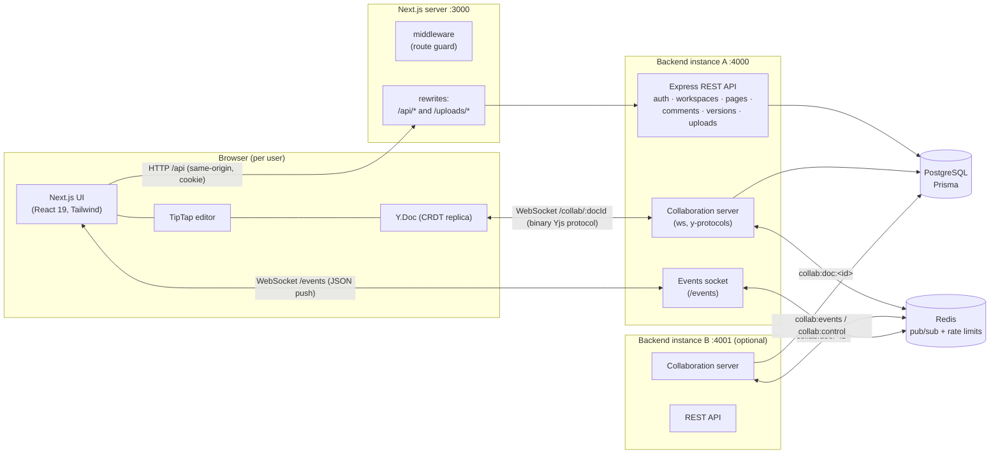
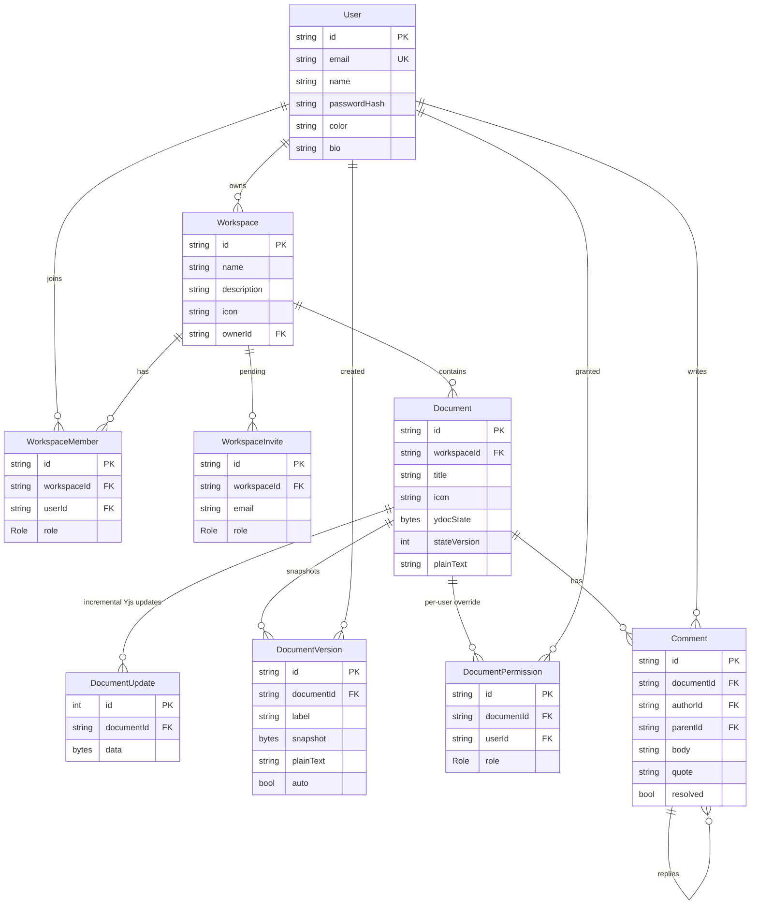

# Architecture

## 1. System overview



* The **browser** talks to the Next.js server for pages and to the API through Next's rewrite proxy (so the session cookie is first-party and CORS is a non-issue). **WebSockets connect directly to the backend** (`NEXT_PUBLIC_WS_URL`) because Next rewrites don't proxy WebSockets.
* The **backend** is stateless apart from in-memory "rooms" (a live `Y.Doc` per open document). Any number of identical instances can run behind a load balancer; **Redis** keeps their rooms consistent.
* **PostgreSQL** is the source of truth. Redis holds nothing that cannot be rebuilt (only messages in flight and rate-limit counters).

## 2. Real-time collaboration

### CRDT
Each document is a Yjs `Y.Doc` whose rich text lives in a `Y.XmlFragment` (`"default"`) bound to ProseMirror by TipTap's `Collaboration` extension.
A CRDT guarantees that any set of concurrent edits converges to the same state on every replica regardless of delivery order, so concurrent
typing never overwrites anything and there is no central "lock".

### Protocol (y-websocket compatible)
The server speaks the standard y-protocols wire format so the stock `y-websocket` client works unmodified:

1. Client connects to `/collab/:docId?token=<ws-token>`. The server authenticates the token and the user's effective role **before** upgrading the connection (401/403 otherwise).
2. Server sends *SyncStep1*; client answers with *SyncStep2*; they exchange missing updates (offline edits merge here).
3. Afterwards every change is a small `update` message broadcast to all other connections of the room.
4. **Awareness** messages (cursor, selection, user name/colour, "typing" timestamp) are ephemeral and never persisted.

### Persistence
```
Document.ydocState   (compacted snapshot, bytea)   +   DocumentUpdate rows (incremental, append-only)
```
* Local updates are batched (250 ms) and appended to `DocumentUpdate`.
* When the last user leaves (or after 100 appended batches) the room **compacts**: `Y.mergeUpdates(state + updates)` → `ydocState`, then deletes the merged rows.
  Compaction is safe with several instances: it is guarded by an optimistic `stateVersion` check and deletes only rows that were part of the merge.
* A document is loaded by applying `ydocState` then all pending `DocumentUpdate`s – so a page refresh or server restart loses nothing.
* A debounced job also stores a plain-text projection (`Document.plainText`) for previews and takes automatic version snapshots.

### Horizontal scaling with Redis
Per open document each instance subscribes to the channel `collab:doc:<id>`:

| Message | Purpose |
|---|---|
| `update` | A Yjs update produced on another instance → applied locally with origin `REMOTE` (never re-persisted or re-published, so no loops/duplicates) |
| `awareness` | Presence/cursor changes from clients on other instances |
| `sync-request` | Sent when an instance opens a room: peers reply with their full state + awareness, closing the small window of un-flushed edits |

Only the instance that *received* an edit from a client persists it. Other channels: `collab:events` (comment/version/page/member push events) and `collab:control` (drop a user's sockets after a role change).
Without `REDIS_URL` the bus is a no-op and the server runs as a single instance.

### Push events
Non-document data (comments, version list, page list, members, permissions) is fetched over REST; a lightweight JSON socket `/events?topic=doc:<id>|ws:<id>` tells clients *when to refetch* (e.g. `{"type":"comments"}`) – authorization is checked at connect time.

## 3. Authorization model

```
Workspace role  ─►  OWNER > EDITOR > COMMENTER > VIEWER
Per-page override (DocumentPermission)  ─►  replaces the role for one page (never for the workspace owner)
Effective role = OWNER ? OWNER : override ?? workspaceRole
```

| Capability | Viewer | Commenter | Editor | Owner |
|---|:-:|:-:|:-:|:-:|
| Read page, comments, versions | ✓ | ✓ | ✓ | ✓ |
| Comment / reply / resolve | | ✓ | ✓ | ✓ |
| Edit page (WebSocket updates accepted) | | | ✓ | ✓ |
| Create pages, rename, save/restore versions | | | ✓ | ✓ |
| Delete page | | | creator only | ✓ |
| Delete others' comments, manage members, page permissions, workspace settings | | | | ✓ |

Checks happen in **one place per surface**: `lib/permissions.ts` for REST, and the upgrade handler + message handler for WebSockets (read-only connections have every non-SyncStep1 sync message dropped).
When a role/membership changes the server closes that user's sockets with code `4403`; the client reconnects and is re-authorized (read-only or rejected).

## 4. Data model


Source of truth: [`prisma/schema.prisma`](../prisma/schema.prisma); SQL in [`prisma/migrations/`](../prisma/migrations).

## 5. Version history & restore
A snapshot stores the **full Yjs state** (`Y.encodeStateAsUpdate`) plus a text preview. Restoring does *not* swap the database row (that would desync live clients);
instead the server opens the live room, saves a "Before restore" snapshot, and replaces the fragment contents **as an ordinary CRDT transaction** using a deep clone of the snapshot's nodes.
Every connected client receives it as a normal update, and it persists like any other edit.

## 6. Frontend structure

```
frontend/src
├─ app/                  routes (App Router): /, /login, /register, (app)/dashboard, profile, w/[id], w/[id]/settings, w/[id]/d/[docId]
├─ components/Shell.tsx  authenticated layout: sidebar, workspace/page lists, mobile drawer
├─ components/editor/    RichEditor (TipTap+Yjs), PresenceBar, CommentsPanel, HistoryPanel, ShareDialog, session (Y.Doc + provider lifecycle)
├─ components/ui.tsx     design-system primitives (Button, Input, Modal, Avatar, Skeleton, EmptyState…)
└─ lib/                  api client, auth context, toast, data hooks (useResource, useEvents)
```

## 7. Key design decisions & trade-offs

| Decision | Why | Trade-off |
|---|---|---|
| Own WebSocket server using y-protocols instead of the stock y-websocket server | Needed auth-before-upgrade, per-connection read-only enforcement, Postgres persistence and Redis fan-out | More code to maintain than `y-websocket`'s bundled server |
| Append-only update log + compaction | Durable on every edit without rewriting a large blob; fast loads after compaction | Short batching window (250 ms) – a hard crash can lose the last fraction of a second |
| Redis pub/sub (not streams) | Simple, low latency; DB is the durable store anyway | A message published while an instance is disconnected is missed → covered by `sync-request` on room open + Yjs sync on client reconnect |
| JSON events socket for comments/versions | Keeps REST as the single write path with validation + auth | One extra socket per open page |
| Same-origin API through Next rewrites | httpOnly cookie works without CORS/CSRF complexity | WebSockets must connect directly to the backend |
| bcryptjs (pure JS) | Installs everywhere (Windows) without native build tools | Slower than native bcrypt (fine at this scale) |
| Prisma 7 + `@prisma/adapter-pg` | Current Prisma architecture (driver adapters) | Requires `prisma.config.ts` (provided) |
