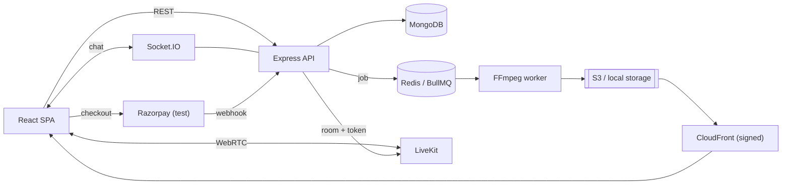

# LearnSphere — Learning Management System with Live Classes

> Full-Stack internship project **FS-03** · MERN + WebRTC (LiveKit) + FFmpeg + BullMQ + AWS CloudFront + Redux Toolkit

A complete online school: instructors build courses with video lessons and quizzes, host **real-time live classes**, and earn revenue; students learn, take auto-graded quizzes, track progress and download **verifiable PDF certificates**; admins moderate the platform.

## 1. Problem statement
Small educators and training teams stitch together separate tools for hosting videos, running live sessions, testing students, issuing certificates and collecting payments. This fragments the learner experience, makes progress impossible to track, and leaves instructors without a clear view of their earnings.

## 2. Objectives
1. One platform with three isolated roles (student / instructor / admin) and strict authorization.
2. Reliable video pipeline: upload → validate → queue → FFmpeg → HLS → secure CDN delivery, with status, retries and failure handling.
3. Real live classes (WebRTC via LiveKit) with chat, participant list and mic/camera controls.
4. Auto-graded quizzes, progress analytics, and verifiable certificates.
5. Instructor revenue dashboard backed by a test-mode payment gateway.
6. Honest integrations: anything needing external credentials is implemented properly, configuration-gated, and **never faked**.

## 3. Features
| Role | Capabilities |
|---|---|
| **Student** | Register/login · Udemy-style catalogue (search, category, level, price, sort) · enrol (free) or pay (test mode) · HLS video player with resume + auto-complete · timed quizzes with instant results & review · join live classes + chat · progress dashboard with charts · PDF certificates · payment history · notifications |
| **Instructor** | Create/edit/delete courses · modules & lessons · video upload with **upload progress**, live **processing status**, retry · quizzes (MCQ, duration, passing marks) · schedule/start/end live classes · enrolled students & progress · **revenue dashboard** (monthly, per-course, transactions with success/pending/failed) |
| **Admin** | Platform dashboard & charts · manage students/instructors (search, filter, suspend, create) · approve/reject courses with reason · monitor enrolments, transactions and an activity audit trail |

Each role has its own layout and visual identity (student: light teal · instructor: indigo studio · admin: dark amber console).

## 4. Technology stack
| Area | Technology |
|---|---|
| Frontend | React 18, Vite, **Redux Toolkit** (+RTK Query), React Router 6, **Tailwind CSS**, Recharts, hls.js, lucide-react |
| Backend | **Node.js, Express**, REST, **JWT**, RBAC, Zod validation, helmet, rate limiting, Winston |
| Database | **MongoDB + Mongoose** (15 models + audit log) |
| Video | **FFmpeg** (fluent-ffmpeg) · **BullMQ** · **Redis** · storage adapter (local ⇄ **AWS S3**) · **AWS CloudFront** signed URLs |
| Live | **LiveKit** (WebRTC SFU) + Socket.IO chat |
| Other | pdfkit + qrcode (certificates) · **Razorpay** test mode (+ labelled simulator) · Jest/Supertest · Vitest/Testing Library · Docker |

## 5. Architecture
See [docs/ARCHITECTURE.md](docs/ARCHITECTURE.md) for full diagrams (system, upload pipeline, live class, payments, **ER diagram**).



## 6. Quick start
**Docker (everything incl. LiveKit):**
```bash
cp .env.example .env            # set JWT_SECRET
docker compose up --build -d
docker compose --profile seed run --rm seed
# open http://localhost:5173
```
**Manual (Windows/PowerShell, macOS, Linux):** see [docs/SETUP.md](docs/SETUP.md) — needs Node 18+, MongoDB, Redis, FFmpeg (+ LiveKit for live classes).
```powershell
.\scripts\setup.ps1
cd backend; npm run seed
cd backend;  npm run dev       # terminal 1  API  :5000
cd backend;  npm run worker    # terminal 2  FFmpeg/BullMQ worker
cd frontend; npm run dev       # terminal 3  UI   :5173
```
Demo logins: `admin@learnsphere.dev / Admin@123` · `priya@learnsphere.dev / Instructor@123` · `rakshitha@learnsphere.dev / Student@123`

## 7. Environment variables
Full annotated lists: [`backend/.env.example`](backend/.env.example), [`.env.example`](.env.example) (Docker), [`frontend/.env.example`](frontend/.env.example).

| Variable | Purpose | Required |
|---|---|---|
| `MONGO_URI`, `REDIS_URL` | database, BullMQ queue | yes |
| `JWT_SECRET` | token signing (server refuses the dev default in production) | yes (prod) |
| `CLIENT_URL`, `API_BASE_URL` | CORS origin, public API URL | yes |
| `STORAGE_DRIVER` (`local`/`s3`), `AWS_*` | storage backend | S3 only |
| `CLOUDFRONT_DOMAIN`, `_KEY_PAIR_ID`, `_PRIVATE_KEY` | signed CDN delivery | CloudFront only |
| `LIVEKIT_URL`, `LIVEKIT_API_KEY`, `LIVEKIT_API_SECRET` | live classes | for live classes |
| `RAZORPAY_KEY_ID`, `_KEY_SECRET`, `_WEBHOOK_SECRET` | payments (empty ⇒ simulated gateway) | optional |
| `FFMPEG_PATH`, `FFPROBE_PATH` | only if not on PATH | optional |

`GET /api/config` reports which integrations are *actually* active (`storage`, `cloudfront`, `livekit`, `payments`).

## 8. API documentation
[docs/API.md](docs/API.md) — 79 endpoints, auto-generated from the route table (method, path, allowed roles, validation) plus conventions, curl examples and Socket.IO events.

## 9. Testing
Executed results (see [docs/TESTING.md](docs/TESTING.md)):

| Suite | Result |
|---|---|
| Backend — Jest + Supertest, real MongoDB/Redis/FFmpeg (10 suites) | **101 passed** (stable across repeated full runs) |
| LiveKit integration against a real `livekit-server` 1.9.0 (opt-in) | **3 passed** |
| API smoke on a seeded server (`tests/e2e-smoke.js`) | **22 / 22 passed** |
| Frontend integration — React app against the live API (Vitest) | **25 / 25 passed** |
| Frontend production build (`vite build`) | succeeds |

```bash
cd backend && npm test              # needs MongoDB, Redis, FFmpeg
node tests/e2e-smoke.js             # needs a running, seeded API
cd frontend && npm test             # needs a running, seeded API
```

## 10. Deployment
[docs/DEPLOYMENT.md](docs/DEPLOYMENT.md): Docker Compose, free-tier recipe (Atlas + Upstash + Render + Vercel + LiveKit Cloud), production checklist, AWS S3/CloudFront setup in [docs/SETUP.md](docs/SETUP.md).

## 11. What is and isn't verified (read this before the demo)
| Item | Status |
|---|---|
| REST API, RBAC, validation, quizzes, progress, certificates, revenue, admin | ✅ automated tests |
| Upload → BullMQ → FFmpeg → HLS → tokenised playback | ✅ tested with a real generated video |
| LiveKit rooms/tokens | ✅ tested against a real LiveKit server; ✅ chat via Socket.IO tested |
| A live **browser-to-browser** WebRTC call | ⚠️ not automatable here — test manually with 2 browsers (SETUP.md) |
| Razorpay checkout | ⚠️ signature/webhook logic tested; Razorpay API call mocked. Add test keys to try the hosted checkout. Without keys the **simulated gateway** is used and labelled as such |
| AWS S3 / CloudFront | ⚠️ implemented (adapter + signed URLs) but **not run against AWS** (no credentials). The app reports `cloudfront:false` and falls back to token-secured streaming until configured |
| Docker Compose | ⚠️ written but not executed in the build environment — run `docker compose config` / `up` on your machine |
| Visual design / responsiveness | ⚠️ built mobile-first, verified by DOM tests and build only — please review in a browser |

## 12. Known limitations
* One video per lesson; transcoding ladder is 360p/720p/1080p (only rungs ≤ source height).
* LiveKit chat uses Socket.IO (persisted) rather than LiveKit data channels; no recording or hand-raise.
* Local storage cannot be shared by API and worker on different hosts — use S3 for multi-host deployments.
* Refunds, coupons, subtitles, course reviews/ratings and email notifications are not implemented (in-app notifications only).
* Quizzes: multiple-choice with a single correct answer; attempts are unlimited.
* JWT is kept in `localStorage` (simple, but exposed to XSS; httpOnly-cookie sessions are a hardening option).

## 13. Future enhancements
Course ratings & reviews · coupons/subscriptions · email + push notifications · live-class recording to S3 · multi-correct and free-text quiz types with manual grading · instructor payouts (Razorpay Route) · subtitles & DRM · refresh tokens + httpOnly cookies · Redis-backed rate limiting · i18n · mobile app (Flutter) using the same API.

## 14. Project layout
```
backend/   src (config, models, validators, middleware, controllers, services, workers, routes, socket, utils) · scripts · tests
frontend/  src (app, components, pages/{public,student,instructor,admin,shared}, tests)
docs/      API · ARCHITECTURE · SETUP · TESTING · DEPLOYMENT · PRESENTATION
tests/     e2e-smoke.js        scripts/  setup.ps1 · setup.sh · run-all-tests.sh · gen-api-docs.js
```
