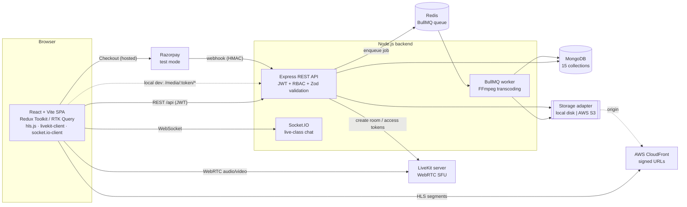
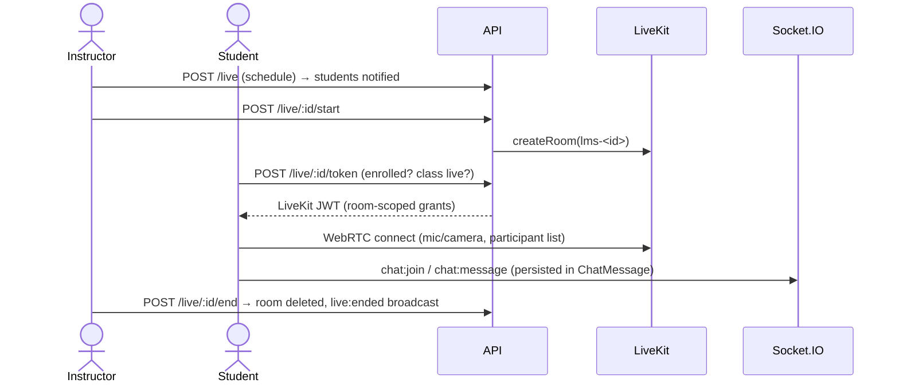
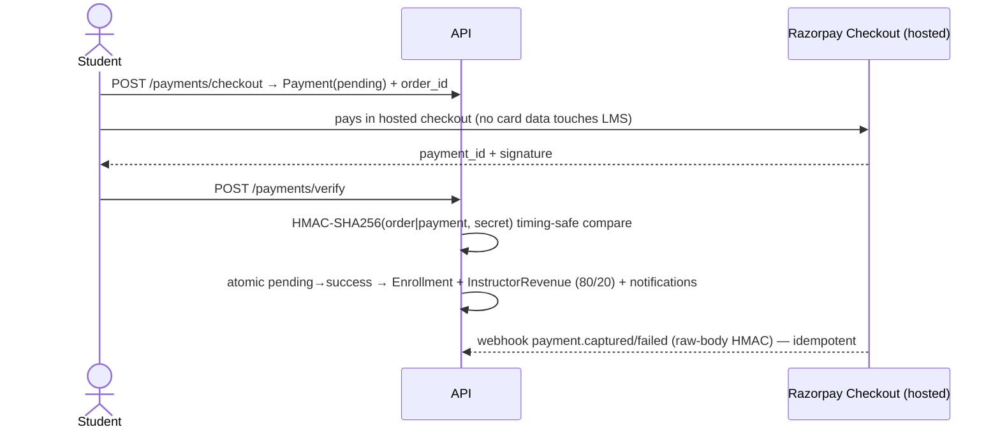
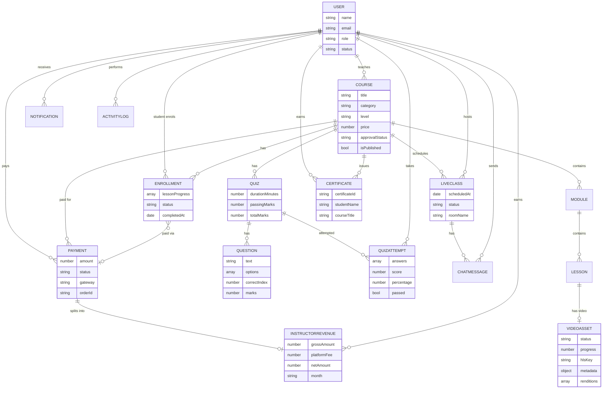

# Architecture

## System architecture



## Folder structure

```
learning-management-system/
├── backend/
│   ├── src/
│   │   ├── config/        env (feature flags), db, redis, logger, constants
│   │   ├── models/        15 Mongoose schemas (+ ActivityLog)
│   │   ├── validators/    Zod request schemas
│   │   ├── middleware/    auth/RBAC, validate, rate-limit, upload, error handler
│   │   ├── controllers/   thin HTTP handlers
│   │   ├── services/      business logic: video, storage adapters, payments, quiz, progress, certificates, LiveKit
│   │   ├── workers/       BullMQ video worker
│   │   ├── routes/        route table
│   │   ├── socket/        Socket.IO chat
│   │   └── utils/         ApiError, token, access helpers, pagination
│   ├── scripts/           seed.js, makeSampleVideo.js
│   └── tests/             Jest + Supertest (real MongoDB, Redis, FFmpeg)
├── frontend/src/
│   ├── app/               Redux store, RTK Query API, slices
│   ├── components/        UI kit, layouts, charts, video player, checkout
│   ├── pages/             public · student · instructor · admin · shared
│   └── tests/             Vitest + Testing Library integration tests
├── docs/  tests/  scripts/  docker-compose.yml
```

Request flow: `route → [authenticate → authorize(role) → validate(zod)] → controller → service → model`.

## Video upload and processing pipeline

```mermaid
sequenceDiagram
  actor I as Instructor
  participant API as Express API
  participant S as Storage adapter
  participant Q as BullMQ (Redis)
  participant W as Worker (FFmpeg)
  participant DB as MongoDB
  I->>API: POST /videos/upload (multipart, XHR progress)
  API->>API: multer type/size check + ffprobe validates real video
  API->>S: store original  uploads/<id>/original.mp4
  API->>DB: VideoAsset(status=queued)
  API->>Q: add job (attempts=3, exponential backoff)
  API-->>I: 202 Accepted
  Q->>W: job
  W->>S: download source
  W->>W: ffprobe metadata → HLS 360p/720p(/1080p) + master.m3u8 + thumbnail
  W->>S: upload videos/<id>/...
  W->>DB: status=ready, progress=100, metadata, lesson.duration
  Note over W,DB: on failure: BullMQ retries; after the last attempt status=failed + notification; instructor can Retry
  I->>API: polls course (status, progress %)
```

**Secure delivery.** `GET /lessons/:id/playback` checks enrolment/ownership, then returns:
* **CloudFront configured** – a wildcard *custom-policy signed URL* for `videos/<asset>/*`; the player appends the signed query to every playlist/segment request.
* **Otherwise** – `/media/<JWT>/master.m3u8`; the JWT is scoped to one asset and expires (default 4 h). Works with local disk or S3 (API proxy, with HTTP Range support).

## Live class flow



## Payment flow (test mode)


Without Razorpay keys the API runs a clearly labelled **simulated** gateway (`gateway: "simulated"`), disabled in production unless `ALLOW_SIMULATED_PAYMENTS=true`.

## Database ER diagram



Key indexes: `Enrollment(student,course)` unique · `Certificate(student,course)` unique · `Certificate.certificateId` unique · `InstructorRevenue.payment` unique (idempotent revenue) · `Course` text index + `(isPublished,approvalStatus,createdAt)` · `QuizAttempt(quiz,student,createdAt)` · `Notification(user,read,createdAt)` · `LiveClass.roomName` unique-sparse.

## Role-based access

| Capability | Student | Instructor | Admin |
|---|:-:|:-:|:-:|
| Browse / enrol / watch / quizzes / progress / certificates | ✔ | – | – |
| Create, edit, delete **own** courses, upload videos, quizzes, schedule & host live classes | – | ✔ | – |
| Revenue dashboard + own transactions | – | ✔ | – |
| Approve / reject courses, manage users, monitor enrolments & transactions, platform stats | – | – | ✔ |

Enforced in three layers: route-level `authorize(...)`, controller-level ownership/enrolment checks, and the React `ProtectedRoute` (UX only — the server is the authority).

## Security measures

bcrypt (cost 12) · JWT with expiry · suspended accounts rejected on every request · Zod validation on every mutating route · helmet · CORS allow-list · rate limiting (stricter on auth) · path-traversal guard on media routes · no card data stored · webhook + checkout HMAC verification with timing-safe compare · quiz answer key never serialised to students · admin role impossible to self-register · secrets only via environment variables.
